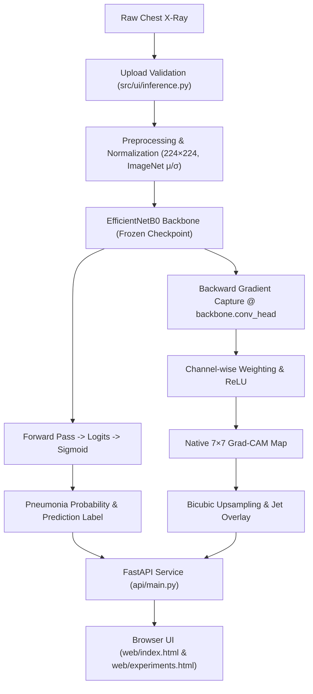

# Project Summary: Explainable Pneumonia Detection from Chest X-Rays

This project is an open, reproducible research and educational platform for chest X-ray classification and interpretability. It addresses the core question: **"Does a given chest radiograph exhibit radiographic patterns consistent with NORMAL or PNEUMONIA?"** and pairs every classification with an explicit, mathematically audited **Grad-CAM (Gradient-weighted Class Activation Mapping)** visual explanation.

> **Medical & Regulatory Disclaimer**: This platform is designed strictly for academic research, algorithm auditing, and machine learning education. It is not an FDA-cleared or CE-marked medical device, and must not be used as a primary diagnostic tool or in clinical decision-making.

---

## 1. What Has Been Implemented

### 1.1 High-Performance Baseline Classifier (EfficientNetB0)
- **Architecture**: Transfer-learned EfficientNetB0 backbone with a custom binary classification head.
- **Classification Objective**: Binary classification between **NORMAL** (0) and **PNEUMONIA** (1).
- **Model Checkpoint**: Frozen checkpoint (`experiments/exp01_efficientnetb0_baseline/best_model.pt`) trained to epoch 8 on the internal training split, achieving **0.9997 validation ROC-AUC**, **99.5% sensitivity**, and **98.5% specificity** at a fixed decision threshold of $0.5$.
- **Parameter Immutability**: All inference, audit, and sensitivity scripts enforce strict parameter freezing ($\sum \theta$ verification) to ensure zero weight mutation during evaluations.

### 1.2 Modern Browser Interface (FastAPI + HTML5/CSS3/Vanilla JS)
The platform features a responsive, decoupled web architecture with a local **FastAPI** backend and modern web frontend:

- **Main Detection Page (`http://127.0.0.1:8000/`)**:
  - Implements a light clinical aesthetic (`web/css/detection.css`) tailored for radiologic dashboards.
  - **Card ① (`1. Upload & Predict`)**:
    - Interactive dashed dropzone with file picker supporting DICOM-derived formats (PNG, JPG, BMP, TIFF up to 15 MB).
    - In-memory validation preventing disk writes during interactive use.
    - Side-by-side chest X-ray viewer with standard radiographic orientation marker (`R`).
    - Mint-green diagnosis indicator card displaying predicted class (`PNEUMONIA` or `NORMAL`), probability formula $P(\text{PNEUMONIA} \mid X)$, status pill badge, large numerical probability readout (e.g. `0.987`), right-aligned percentage (`98.7%`), full-width progress bar, and fixed decision threshold indicator ($0.5$).
    - Prominent clinical callout detailing that predictions represent model likelihoods rather than calibrated diagnostic diagnoses.
  - **Card ② (`2. Grad-CAM Explanation`)**:
    - Triple-image comparison panel displaying:
      1. **Original Radiograph**
      2. **Grad-CAM Heatmap (Upsampled)** with an attached vertical **Jet colorbar gradient** calibrated from $1.0$ (peak activation) to $0.0$ (baseline)
      3. **Heatmap Overlay** blended onto anatomical structures
    - Architectural details card detailing: Target Layer (`backbone.conv_head`), Native Grid Resolution ($7 \times 7$), Upsampling method (`Bicubic 224×224`), Normalization (`Min-max [0, 1]`), and ReLU application (`Pre-upsampling`).
    - Explainability disclaimer clarifying that activations reflect model correlation rather than anatomical segmentation.

- **Experiment Results & Audits Page (`http://127.0.0.1:8000/experiments.html`)**:
  - A comprehensive three-tab dashboard grounded strictly in saved research artifacts:
    - **Tab 1: Experiment 1 — Baseline**: Validation metric cards, confusion matrix details, ROC-AUC curve note, and full multi-epoch training/validation loss and AUC charts via Chart.js.
    - **Tab 2: Experiment 2A — Grad-CAM Audit**:
      - 16-case deterministic gallery (Original / Heatmap / Overlay).
      - **Border vs. Inner Activation Section with Image Grid ⇄ Bar Charts Toggle**: Default Image Grid renders all 16 cases as visual cards with audited native $7 \times 7$ border mean ($24$ cells), inner mean ($25$ cells), and exact ratios (with undefined ratio handled for zero inner activation). Clicking any card opens a high-resolution 3-image modal view with full metrics.
      - Native $7 \times 7$ vs. upsampled bicubic/nearest-neighbour comparison gallery.
    - **Tab 3: Experiment 2B — Sensitivity Pilot**:
      - Summary cards for 3 perturbation conditions (32 px Border Black, 156×156 Central Black, and $\gamma=0.85$ Gamma Darkening).
      - Aggregate mean absolute probability change $|\Delta P|$ and prediction flip bar charts.
      - Horizontal per-image $|\Delta P|$ comparison chart across all 16 cases.
      - **Section ④: Perturbation Images Gallery**: Complete 16-row matrix showing the exact images under all 4 conditions with top color-stripe indicators, post-perturbation probabilities, $\Delta P$, and $\bigstar$ FLIP badges.

### 1.3 In-Memory Preprocessing & Inference Engine
- Robust upload validation (`src/ui/inference.py`) verifying file signatures, image decodability, dimension limits, and RGB conversions.
- ImageNet standardization ($\mu = [0.485, 0.456, 0.406]$, $\sigma = [0.229, 0.224, 0.225]$) matching training transforms.
- In-memory execution: zero temporary files written to disk during user predictions.
- Sigmoid activation over raw logits with probability thresholds configured in `configs/config.yaml`.

### 1.4 Native-Resolution Grad-CAM Explainability
- Custom hook-based Grad-CAM (`src/explainability/gradcam.py`) tapping the final convolutional feature extractor (`backbone.conv_head`).
- Computes global average pooled gradients as channel weights.
- Applies ReLU rectification prior to spatial interpolation, preventing negative activations from artificially cancelling positive regions.
- Preserves raw native $7 \times 7$ activation matrices for mathematical audits alongside 224×224 bicubic upsampled overlays.

### 1.5 Strict Data Auditing & Leakage Prevention
- **Manifest Architecture**: Images are indexed via explicit CSV manifests (`data/manifests/`):
  - `train_manifest.csv`
  - `val_manifest.csv`
  - `calibration_manifest.csv`
  - `test_manifest.csv` (strictly isolated)
- **Duplicate & Overlap Detection**: Automated hashing and token extraction (`build_manifests.py`, `verify_counts.py`) identify exact duplicate images and patient-token overlap, preventing optimistic data leakage between splits.

### 1.6 Experimental Research Series (Exp 01 to Exp 06)
1. **Exp 01 — Baseline Training**: Fully reproducible training run with early stopping, TensorBoard logging, and environment metadata capture.
2. **Exp 02A — Grad-CAM Audit**: Systematic inspection of 16 stratified validation cases (all FP/FN, stratified TP/TN); mathematically audited border versus inner activations at the native $7 \times 7$ feature level.
3. **Exp 02B — Sensitivity Pilot**: Controlled perturbation pilot (32 px border blackout, 156 px central blackout, gamma darkening) testing the model's reliance on peripheral margins versus central lung fields.
4. **Exp 03 — Full-Validation Robustness**: Stress tests across validation data evaluating accuracy and F1 degradation under synthetic artifacts.
5. **Exp 04 — Calibration & Uncertainty**: Temperature scaling and Monte Carlo (MC) dropout evaluations exploring prediction confidence reliability.
6. **Exp 05 — Explanation Faithfulness**: Pixel deletion and insertion curve audits measuring whether Grad-CAM heatmaps genuinely reflect features governing model outputs.
7. **Exp 06 — Expert Mask Localization**: Framework ready to evaluate Grad-CAM localization against clinical bounding boxes/masks once expert annotations are provided.


## 2. End-to-End System Workflow



---

## 3. Directory Layout & Core Files

```text
Pneumonia_Detection/
├── api/
│   └── main.py                     # FastAPI application & artifact endpoints
├── app.py                          # Local server launcher (python app.py)
├── configs/
│   └── config.yaml                 # Central configuration for paths, model, training
├── data/
│   ├── chest_xray/                 # Source radiographs (NORMAL & PNEUMONIA)
│   └── manifests/                  # Audited CSV manifests for train, val, cal, test
├── experiments/
│   ├── exp01_efficientnetb0_baseline/
│   ├── exp02a_gradcam/
│   ├── exp02b_gradcam_sensitivity_pilot/
│   │   └── images/                 # 64 pre-rendered perturbation PNG artifacts
│   ├── exp02b_perturbation/
│   ├── exp03_validation_robustness/
│   ├── exp04_calibration_uncertainty/
│   ├── exp05_explanation_faithfulness/
│   └── exp06_expert_localization/
├── src/
│   ├── config.py                   # Config loading & validation
│   ├── data/                       # Dataset & DataLoader modules
│   ├── explainability/             # Grad-CAM & evaluation modules
│   ├── models/                     # EfficientNetB0 classifier definition
│   ├── training/                   # Trainer, metrics, checkpointing
│   └── ui/                         # In-memory inference & validation helpers
├── tests/                          # 10 automated test suites
├── web/
│   ├── css/
│   │   ├── detection.css           # Clinical light theme for main detection page
│   │   └── style.css               # Global tokens, modals, and experiments theme
│   ├── js/
│   │   ├── charts.js               # Chart.js helper wrappers
│   │   ├── experiments.js          # Experiment tabs, toggles, and perturbation strips
│   │   └── main.js                 # Prediction UI interactions & API client
│   ├── experiments.html            # Research dashboard (Exp 1, 2A, 2B)
│   └── index.html                  # Main detection & Grad-CAM interface
├── build_manifests.py              # Manifest creation & leakage audit tool
├── file_content.md                 # Granular project file index
├── project_summary.md              # High-level architecture & summary (this document)
├── requirements.txt                # Python dependencies
└── train.py                        # Standalone model training script
```

---

## 4. Current Limitations & Scope Boundaries

1. **Fixed Decision Boundary**: Predictions use a fixed threshold ($p \ge 0.5$). While clinically optimized thresholds can maximize sensitivity, tuning requires isolated calibration sets.
2. **Confidence Calibration**: Raw probabilities reflect neural network sigmoid outputs and should not be interpreted as absolute diagnostic risk without formal calibration.
3. **Correlative Nature of Saliency**: Grad-CAM highlights image regions influential to the neural network's activation; it does not constitute clinical segmentation or proof of pathology.
4. **Cohort Scope**: The model was evaluated on validation splits derived from the source dataset. Clinical deployment would necessitate rigorous multi-center external validation across diverse patient demographics and radiographic hardware.
5. **No Medical Advice**: The system is an educational and algorithmic audit tool. It must never substitute for interpretation by a licensed board-certified radiologist.
