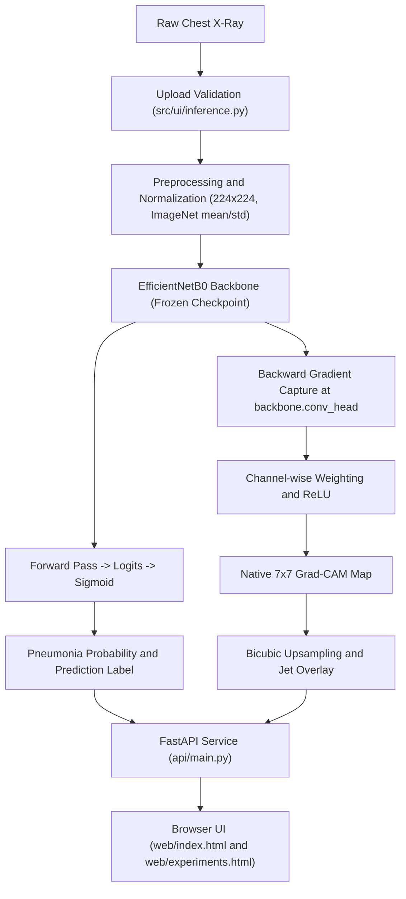

# Project Summary: Explainable Pneumonia Detection from Chest X-Rays

This project is an open, reproducible research and educational platform for chest X-ray classification and interpretability. It addresses the core question: **"Does a given chest radiograph exhibit radiographic patterns consistent with NORMAL or PNEUMONIA?"** and pairs every classification with an explicit, mathematically audited **Grad-CAM (Gradient-weighted Class Activation Mapping)** visual explanation.

> **Medical & Regulatory Disclaimer**: This platform is designed strictly for academic research, algorithm auditing, and machine learning education. It is not an FDA-cleared or CE-marked medical device, and must not be used as a primary diagnostic tool or in clinical decision-making.

---

## 1. What Has Been Implemented

### 1.1 High-Performance Baseline Classifier (EfficientNetB0)
- **Architecture**: Transfer-learned EfficientNetB0 backbone with a custom binary classification head.
  - Backbone: EfficientNetB0 feature extractor (ImageNet pretrained)
  - Classifier: Dropout(0.2) -> Linear(1280, 1)
  - Loss: BCEWithLogitsLoss | Optimizer: AdamW (lr=1e-4, weight_decay=1e-4)
  - Scheduler: CosineAnnealingLR (T_max=14) | Input: 224x224 RGB, ImageNet normalization
- **Classification Objective**: Binary classification between **NORMAL** (0) and **PNEUMONIA** (1).
- **Training Run**: 14 epochs (0-13) with early stopping; best checkpoint selected at **Epoch 8** by minimum validation loss.
- **Model Checkpoint**: Frozen checkpoint (`experiments/exp01_efficientnetb0_baseline/best_model.pt`) achieving:
  - Validation ROC-AUC: **0.9997** | Validation Sensitivity: **99.48%** | Validation Specificity: **98.51%**
  - Validation F1: **0.9948** | Validation Loss (BCE): **0.0220**
  - Full confusion matrix (n=518): TN=132, FP=2, FN=2, TP=382
- **Parameter Immutability**: All inference, audit, and sensitivity scripts enforce strict parameter freezing (sum-of-abs verification) to ensure zero weight mutation during evaluations.

### 1.2 Modern Browser Interface (FastAPI + HTML5/CSS3/Vanilla JS)
The platform features a responsive, decoupled web architecture with a local **FastAPI** backend and modern web frontend:

- **Main Detection Page (`http://127.0.0.1:8000/`)**:
  - Implements a light clinical aesthetic (`web/css/detection.css`) tailored for radiologic dashboards.
  - **Card 1 (`1. Upload & Predict`)**:
    - Interactive dashed dropzone with file picker supporting DICOM-derived formats (PNG, JPG, BMP, TIFF up to 15 MB).
    - In-memory validation preventing disk writes during interactive use.
    - Side-by-side chest X-ray viewer with standard radiographic orientation marker (`R`).
    - Mint-green diagnosis indicator card displaying predicted class (`PNEUMONIA` or `NORMAL`), probability, status pill badge, large numerical probability readout, right-aligned percentage, full-width progress bar, and fixed decision threshold indicator (0.5).
    - Prominent clinical callout detailing that predictions represent model likelihoods rather than calibrated diagnostic diagnoses.
  - **Card 2 (`2. Grad-CAM Explanation`)**:
    - Triple-image comparison panel: Original Radiograph, Grad-CAM Heatmap (Upsampled) with Jet colorbar gradient, and Heatmap Overlay blended onto anatomical structures.
    - Architectural details card: Target Layer (`backbone.conv_head`), Native Grid Resolution (7x7), Upsampling (`Bicubic 224x224`), Normalization (Min-max [0,1]), ReLU (Pre-upsampling).
    - Explainability disclaimer clarifying activations reflect model correlation, not anatomical segmentation.

- **Experiment Results & Audits Page (`http://127.0.0.1:8000/experiments.html`)**:
  - A comprehensive three-tab dashboard grounded strictly in saved research artifacts:
    - **Tab 1: Experiment 1 -- Baseline**: Validation metric cards, confusion matrix, and multi-epoch training/validation loss and AUC charts via Chart.js.
    - **Tab 2: Experiment 2A -- Grad-CAM Audit**: 16-case deterministic gallery (Original / Heatmap / Overlay); border vs. inner activation image grid / bar chart toggle; native 7x7 vs. upsampled comparison gallery.
    - **Tab 3: Experiment 2B -- Sensitivity Pilot**: Summary cards for 3 perturbation conditions; aggregate mean |delta-P| and flip charts; per-image comparison chart; complete 16-row perturbation image matrix with FLIP badges.

### 1.3 In-Memory Preprocessing & Inference Engine
- Robust upload validation (`src/ui/inference.py`) verifying file signatures, image decodability, dimension limits, and RGB conversions.
- ImageNet standardization (mean=[0.485, 0.456, 0.406], std=[0.229, 0.224, 0.225]) matching training transforms.
- In-memory execution: zero temporary files written to disk during user predictions.
- Sigmoid activation over raw logits with probability thresholds configured in `configs/config.yaml`.

### 1.4 Native-Resolution Grad-CAM Explainability
- Custom hook-based Grad-CAM (`src/explainability/gradcam.py`) tapping the final convolutional feature extractor (`backbone.conv_head`).
- Computes global average pooled gradients as channel weights.
- Applies ReLU rectification **prior** to spatial interpolation, preventing negative activations from artificially cancelling positive regions.
- Preserves raw native 7x7 activation matrices for mathematical audits alongside 224x224 bicubic upsampled overlays.
- Explanation faithfulness evaluation utilities in `src/explainability/evaluation.py`.

### 1.5 Strict Data Auditing & Leakage Prevention
- **Manifest Architecture**: Images are indexed via explicit CSV manifests (`data/manifests/`):
  - `train_manifest.csv`, `val_manifest.csv`, `val_reference_16.csv` (16 stratified reference cases for Exp 2A/2B)
  - `calibration_manifest.csv`, `test_manifest.csv` (strictly isolated)
  - `duplicates_manifest.csv` (exact-duplicate report), `leakage_report.json`, `split_summary.json`
- **Duplicate & Overlap Detection**: Automated hashing and token extraction (`build_manifests.py`, `verify_counts.py`) identify exact duplicate images and patient-token overlap, preventing data leakage between splits.

### 1.6 Experimental Research Series (Exp 01 to Exp 06)
All six experiments are implemented. Experiments 01, 02A, 02B, 03, 04, and 05 have been fully executed with results saved as artifacts. Experiment 06 has a framework and evaluation script ready but awaits expert-annotated masks.

1. **Exp 01 -- Baseline Training** (`experiments/exp01_efficientnetb0_baseline/`): Fully reproducible 14-epoch training run with early stopping, TensorBoard logging, and environment metadata capture. Best checkpoint: Epoch 8.
2. **Exp 02A -- Grad-CAM Audit** (`experiments/exp02a_gradcam/`): 16 stratified validation cases audited; mathematically verified border versus inner activations at native 7x7 level. `followup/` includes bicubic vs. nearest-neighbour upsampling comparison galleries.
3. **Exp 02B -- Sensitivity Pilot** (`experiments/exp02b_gradcam_sensitivity_pilot/`): Controlled perturbation pilot (32 px border blackout, 156 px central blackout, gamma=0.85 darkening). 64 pre-rendered PNG artifacts in `images/`. Full results in `sensitivity_results.csv`, `sensitivity_summary.json`, `sensitivity_report.md`.
4. **Exp 03 -- Full-Validation Robustness** (`experiments/exp03_validation_robustness/`): Stress tests across all 518 validation images under brightness (+/-10%), contrast (+/-10%), JPEG compression, gamma darkening, and OOD black-mask conditions. Per-image results in `validation_robustness_results.csv`.
5. **Exp 04 -- Calibration & Uncertainty** (`experiments/exp04_calibration_uncertainty/`): Temperature scaling (T=2.860) on 489-image calibration split; MC-dropout (50 stochastic passes) for uncertainty estimation; ECE, NLL, Brier score, and error-ranking AUROC reported. Results in `calibration_uncertainty_audit.csv`.
6. **Exp 05 -- Explanation Faithfulness** (`experiments/exp05_explanation_faithfulness/`): Pixel deletion and insertion curve audits across all 518 validation images using Gaussian-blurred replacement; paired Grad-CAM vs. random-control advantage with image-bootstrap 95% CIs. Results in `faithfulness_results.csv`.
7. **Exp 06 -- Expert Mask Localization** (`experiments/exp06_expert_localization/`): Framework and `evaluate_localization.py` ready; awaits expert annotations. `annotations_manifest_template.csv` supplied for annotation ingestion.


## 2. End-to-End System Workflow



---

## 3. Directory Layout & Core Files

```text
Pneumonia_Detection/
├── api/
│   └── main.py                     # FastAPI application and artifact endpoints
├── app.py                          # Local server launcher (python app.py)
├── configs/
│   └── config.yaml                 # Central configuration for paths, model, training
├── data/
│   ├── chest_xray/                 # Source radiographs (NORMAL and PNEUMONIA)
│   └── manifests/
│       ├── train_manifest.csv
│       ├── val_manifest.csv
│       ├── val_reference_16.csv    # 16 stratified cases for Exp 2A/2B
│       ├── calibration_manifest.csv
│       ├── test_manifest.csv       # Strictly isolated
│       ├── duplicates_manifest.csv # Exact-duplicate report
│       ├── leakage_report.json
│       └── split_summary.json
├── experiments/
│   ├── exp01_efficientnetb0_baseline/
│   │   ├── best_model.pt           # Frozen checkpoint (Epoch 8)
│   │   ├── last_model.pt
│   │   ├── training_history.json   # Per-epoch metrics (14 epochs)
│   │   ├── config_snapshot.json
│   │   ├── environment_metadata.json
│   │   └── training.log
│   ├── exp02a_gradcam/
│   │   ├── gradcam_metadata.json   # 16-case audit metadata
│   │   ├── contact_sheet.png
│   │   ├── heatmaps/  originals/  overlays/
│   │   ├── numerical_audit/        # CSV/JSON audit replication artefacts
│   │   └── followup/               # Bicubic vs. nearest-neighbour comparisons
│   ├── exp02b_gradcam_sensitivity_pilot/
│   │   ├── sensitivity_pilot.py    # Pre-committed perturbation script
│   │   ├── sensitivity_results.csv / sensitivity_summary.json / sensitivity_report.md
│   │   ├── sensitivity_contact_sheet.png
│   │   └── images/                 # 64 pre-rendered perturbation PNG artifacts
│   ├── exp02b_perturbation/        # Supporting perturbation utilities
│   ├── exp03_validation_robustness/
│   │   ├── run_validation_robustness.py
│   │   └── validation_robustness_results.csv / _summary.json / _report.md
│   ├── exp04_calibration_uncertainty/
│   │   ├── run_calibration_uncertainty.py
│   │   └── calibration_uncertainty_audit.csv / _summary.json / _report.md
│   ├── exp05_explanation_faithfulness/
│   │   ├── run_faithfulness_audit.py
│   │   └── faithfulness_results.csv / faithfulness_summary.json / faithfulness_report.md
│   └── exp06_expert_localization/
│       ├── evaluate_localization.py
│       ├── annotations_manifest_template.csv
│       └── README.md
├── src/
│   ├── config.py                   # Config loading and validation
│   ├── data/                       # Dataset and DataLoader modules
│   ├── explainability/
│   │   ├── gradcam.py              # Hook-based Grad-CAM implementation
│   │   └── evaluation.py           # Faithfulness evaluation utilities
│   ├── models/
│   │   └── model.py                # EfficientNetB0 classifier definition
│   ├── training/
│   │   ├── trainer.py              # Training loop and early stopping
│   │   ├── metrics.py              # ROC-AUC, sensitivity, specificity, F1
│   │   ├── checkpoints.py          # Checkpoint save/load
│   │   ├── components.py           # Optimizer, scheduler, loss setup
│   │   └── runtime.py              # Environment metadata capture
│   └── ui/
│       └── inference.py            # In-memory inference and upload validation
├── tests/                          # 11 automated test modules (175 collected test functions)
│   ├── test_training_loop.py
│   ├── test_gradcam.py
│   ├── test_gradcam_numerical_audit.py
│   ├── test_sensitivity_pilot.py
│   ├── test_data_pipeline.py
│   ├── test_ui_integration.py
│   ├── test_calibration_uncertainty.py
│   ├── test_validation_robustness.py
│   ├── test_explanation_evaluation.py
│   ├── test_faithfulness_audit.py
│   └── test_experiment_visualization_api.py
├── web/
│   ├── css/
│   │   ├── detection.css           # Clinical light theme for main detection page
│   │   ├── style.css               # Global tokens, modals, and experiments theme
│   │   └── theme.css               # Shared design tokens and component styles
│   ├── js/
│   │   ├── charts.js               # Chart.js helper wrappers
│   │   ├── experiments.js          # Experiment tabs, toggles, perturbation strips
│   │   └── main.js                 # Prediction UI interactions and API client
│   ├── experiments.html            # Research dashboard (Exp 1, 2A, 2B)
│   └── index.html                  # Main detection and Grad-CAM interface
├── build_manifests.py              # Manifest creation and leakage audit tool
├── run_exp02a.py                   # Standalone Exp 2A Grad-CAM audit runner
├── verify_counts.py                # Dataset count and overlap verification
├── file_content.md                 # Granular project file index
├── project_description.md          # Full research description and results
├── project_summary.md              # High-level architecture and summary (this document)
├── requirements.txt                # Python dependencies
└── train.py                        # Standalone model training script
```

---

## 4. Current Limitations & Scope Boundaries

1. **Fixed Decision Boundary**: Predictions use a fixed threshold (p >= 0.5). While clinically optimized thresholds can maximize sensitivity, tuning requires isolated calibration sets.
2. **Confidence Calibration**: Raw probabilities reflect neural network sigmoid outputs and should not be interpreted as absolute diagnostic risk without formal calibration. Temperature-scaled probabilities (Exp 04) reduce ECE on the internal calibration partition but do not establish clinical-grade calibration.
3. **Correlative Nature of Saliency**: Grad-CAM highlights image regions influential to the neural network's activation; it does not constitute clinical segmentation or proof of pathology.
4. **Pilot Scale (n=16)**: The Exp 2A/2B analyses cover a selected, stratified subset of 16 cases. Results must not be generalised to the full 518-image validation set or beyond.
5. **OOD Perturbations**: Large black masks (border or central) fall outside the training distribution. Model responses to these perturbations cannot be interpreted as principled feature attributions.
6. **Cohort Scope**: The model was evaluated on validation splits derived from the source dataset (Guangzhou Women and Children's Medical Center). Clinical deployment would necessitate rigorous multi-center external validation across diverse patient demographics and radiographic hardware.
7. **No Medical Advice**: The system is an educational and algorithmic audit tool. It must never substitute for interpretation by a licensed board-certified radiologist.
